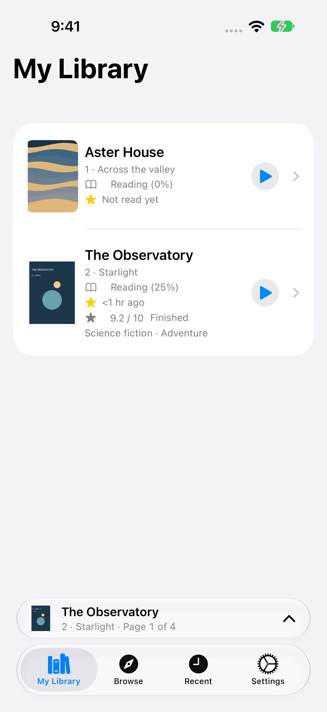
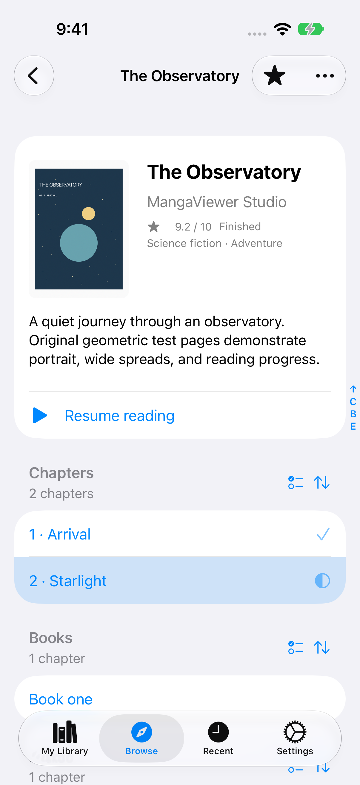
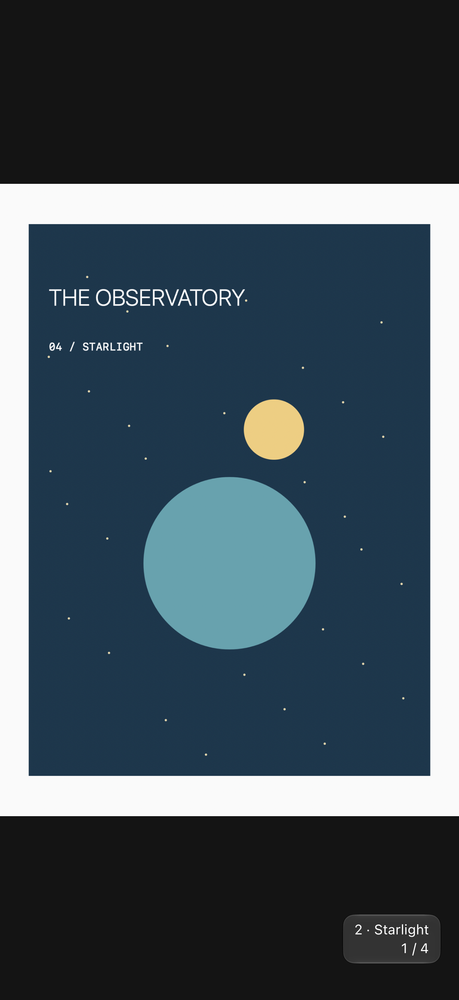

<p align="center">
  
</p>

# dokidoki"

A native manga reader for iPhone, iPad, Mac, and Apple Vision Pro. Browse your favorite sites, keep a personal library, and read with a quiet, immersive interface. Add support for websites through shareable JSON rules.

<p align="center">
  
  
  
</p>

*Real app screenshots using the original artwork in the bundled reading room.*

## What you can do

- **Keep your place.** Save and star manga, revisit recent reading, and resume from the same page—even after closing the app. Mark chapters or whole groups read, unread, or ignored.
- **Read your way.** Choose paged or continuous scrolling, either reading direction, facing pages in wide windows, margin trimming, and automatic split-page joining.
- **Stay immersed.** Tap the artwork to hide controls while keeping a small chapter/page badge. Pull beyond either chapter boundary by 20% of the viewport and release to switch chapters. Collapse the reader into a small Resume bar when browsing.
- **Explore websites.** Browse shelves, search, use source-provided sorting, and automatically load more as you approach the end of a list. MangaCopy, Manhuagui, and an offline example reading room are included.
- **Use your devices naturally.** Native floating controls on iPhone/iPad, adaptive iPhone Duo layouts, a Mac sidebar, and a resizable reader window on Vision Pro. English and Simplified Chinese interfaces are included.

Your library and reading history stay on your device. This preview does not include iCloud synchronization or full-library offline downloads. Website availability depends on the source and its installed rule.

## Requirements

| Platform | Minimum supported version |
| --- | --- |
| iPhone and iPad | iOS / iPadOS 26 |
| iPhone Duo | iOS 27.1 |
| Mac | macOS 26 |
| Apple Vision Pro | visionOS 26 |

The current release is **0.1.0**. Settings → About shows the release and a unique build number. Build from source with **Xcode 27.1**, the relevant platform SDKs, and Swift 6 language mode. Install the corresponding simulator runtime to run a simulator; iPhone Duo uses the iOS 27.1 runtime in Device Hub.

## Get started

1. Open **Browse** and choose a site with the globe button. Choose **Bundled reading room** to try the app without a network connection.
2. Open a manga and tap its star to save it to **My Library**. Tap **Start reading** or a chapter to begin.
3. Tap the artwork to toggle immersive mode. Use **Reader options** to change reading mode and direction. To collapse the reader, pull down from the top in paged mode, or swipe inward from the left edge in scroll mode.
4. Return through the **Resume** bar, or use the play button beside a book in Library or Recent. Tap the book itself to see its details.

Settings also provides site-rule import/export, reader defaults, cache controls, and an error report you can review and share yourself.

## Build and run

```sh
git clone https://github.com/depctg/dokidoki.git
cd dokidoki
open MangaViewer.xcodeproj
```

In Xcode, select the **MangaViewer** scheme and a Mac, iPhone/iPad simulator, or Vision Pro destination, then Run. Swift Package Manager resolves the dependencies automatically; no project generator is needed.

For a physical iPhone or iPad, select your Apple development team under **Signing & Capabilities**, connect and trust the device, enable Developer Mode if prompted, and Run. A Personal Team works for a local preview; provisioning and renewal are managed by Xcode.

To build for the iOS simulator from the terminal:

```sh
xcodebuild -project MangaViewer.xcodeproj -scheme MangaViewer \
  -destination 'generic/platform=iOS Simulator' \
  -derivedDataPath build CODE_SIGNING_ALLOWED=NO build
```

Run the core tests with `swift test --package-path Packages/MangaCore`. Run core tests and all three platform builds with `bash scripts/verify.sh`. For UI tests, select a dedicated iPhone/iPad simulator in Xcode and use Product → Test; the tests change that simulator's library and reader preferences.

## Create a site rule with AI

A rule describes a website's browse lists, search, manga metadata, chapter order, and page images. All website-specific parsing lives in JSON; rules cannot import executable scripts.

1. Give a capable coding AI this repository, the [AI authoring prompt](rule-authoring/PROMPT.md), and the [rule-authoring guide](rule-authoring/GUIDE.md).
2. Fill in the site's public URL, example directory/manga/chapter URLs, and a search query. Ask the AI to inspect normal site behavior and produce a rule JSON file plus a record of what it actually verified.
3. Have it validate complete chapter order and page counts, decoded images, search, and pagination where supported. The guide includes probe commands; for example:

   ```sh
   swift run --package-path Packages/MangaCore manga-probe \
     --rule /path/to/site.json --rendered --previews 'https://reader.example/catalog'
   ```

4. Import the resulting JSON in **Settings → Site rules**, review its allowed hosts, and try it in the app. You can export rules to share them. Updating a rule keeps your saved books and reading history.

The [rule format reference](docs/RULES.md) lists supported fields and examples. Keep the same rule ID and increment its version when updating a recipe.

## More documentation

- [Design and architecture](docs/MangaViewer_DESIGN.md)
- [Development state, verification, and known limitations](docs/DEV_STATE.md)
- [Image processing](docs/IMAGE_PROCESSING.md) · [Localization](docs/LOCALIZATION.md) · [Error reports](docs/DIAGNOSTICS.md)
- [Icon Composer source and workflow](docs/ICON.md) · [Screenshot provenance](docs/images/README.md)
- [Development conventions](AGENTS.md)

## License

[MIT](LICENSE), © 2026 depctg. Third-party dependencies and website content retain their respective licenses and rights.
